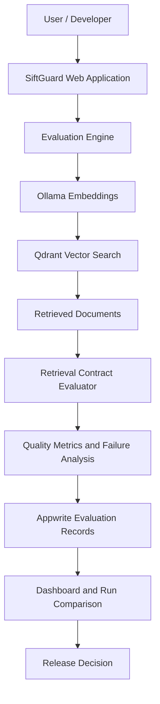

<div align="center">

# 🛡️ SiftGuard

### Make Semantic Search Reliable. Detect Regressions Before Release.

**SiftGuard is a semantic retrieval evaluation and reliability platform that tests whether AI-powered search retrieves the right information, respects tenant boundaries, and maintains quality across changes.**

<br />

[](https://github.com/Gineeth4/SiftGuard/actions/workflows/ci.yml)


<br />

[**Explore Features**](#-features) ·
[**How It Works**](#-how-it-works) ·
[**Get Started**](#-getting-started) ·
[**Run the Demo**](#-try-the-regression-demo) ·
[**Testing**](#-testing)

</div>

---

## 📌 The Problem

AI-powered applications increasingly rely on semantic search and vector databases to retrieve information relevant to a user's query. However, a search system can return results without returning the *right* results.

A small change to an embedding model, retrieval configuration, filter, or corpus can introduce problems such as:

- **Missing information:** A document that should have been retrieved no longer appears in the results.
- **Quality regressions:** A new version performs worse than a previously working version.
- **Forbidden results:** Sensitive or irrelevant documents appear in the retrieved results.
- **Tenant-isolation failures:** A query uses the wrong tenant filter and retrieves information from an unintended tenant.
- **Invisible failures:** The search request succeeds technically even though the retrieval quality has deteriorated.

Traditional application tests often check whether an API returns successfully. SiftGuard goes further by checking whether the returned information satisfies explicit retrieval-quality expectations.

## 💡 What Is SiftGuard?

SiftGuard brings software-testing principles to semantic retrieval.

It evaluates retrieval results against test cases and contracts, calculates quality metrics, records experiment outcomes, and compares candidate runs against successful baselines. It also supports controlled fault-injection scenarios that demonstrate whether an evaluation can detect an intentionally introduced regression.

Instead of asking only:

> Did the search request succeed?

SiftGuard asks:

> Did the search retrieve the expected information, avoid forbidden documents, and preserve the quality we require?

---

## ✨ Features

<details open>
<summary><strong>1. Semantic Retrieval Evaluation</strong></summary>

Evaluate actual vector-search results against predefined test cases.

Each test case can include a natural-language query, tenant configuration, a Top-K limit, required documents, forbidden documents, and rank expectations.

SiftGuard records whether each case passes or fails and provides failure details for investigation.

</details>

<details>
<summary><strong>2. Retrieval Quality Metrics</strong></summary>

Measure retrieval quality using:

| Metric | What it measures |
|---|---|
| **Recall@K** | The proportion of relevant expected documents retrieved within the top K results |
| **Precision@K** | The proportion of retrieved results that are relevant |
| **Mean Reciprocal Rank (MRR)** | How highly the first relevant result is ranked |
| **nDCG@K** | Ranking quality when graded relevance judgments are available |
| **Latency** | The time taken to execute a retrieval operation |

SiftGuard also tracks forbidden-result violations and checks relevant tenant-isolation expectations.

Metrics are meaningful only when their underlying relevance judgments and evaluation data are valid. For example, nDCG should not be interpreted as a measured result when graded relevance labels are unavailable.

</details>

<details>
<summary><strong>3. Baseline vs. Candidate Comparison</strong></summary>

Compare a known baseline evaluation with a candidate run to identify changes in retrieval quality.

The comparison utilities report metric deltas, differences in case outcomes, and regression indicators.

Latency variation is reported separately from confirmed quality regressions so that a single noisy timing measurement does not automatically imply that retrieval quality has regressed.

</details>

<details>
<summary><strong>4. Retrieval Contracts and Failure Explanations</strong></summary>

Define explicit expectations for search behavior.

Examples include:

- A required document must appear within the allowed rank.
- A designated forbidden document must not appear.
- Recall must meet a configured threshold.
- A candidate must not introduce a new failed test case.

When an expectation fails, SiftGuard records relevant result information and failure details to make debugging more direct.

</details>

<details>
<summary><strong>5. Tenant-Isolation Testing</strong></summary>

Test whether retrieval respects the intended tenant filter.

The demonstration includes a wrong-tenant-filter scenario that deliberately changes the filter for a query and checks whether the resulting regression is detected.

**Important:** Evaluation checks complement application-level access controls. They are not a replacement for enforcing authorization and tenant boundaries within the data-access layer.

</details>

<details>
<summary><strong>6. Reproducibility and Experiment Records</strong></summary>

SiftGuard stores evaluation data in Appwrite, including:

- Test suites and test cases
- Retrieval contracts and document rules
- Evaluation runs and per-case results
- Corpus document metadata

The project also includes utilities for configuration fingerprints and experiment metadata snapshots. These help identify changes in the recorded configuration.

Configuration fingerprints and metadata snapshots are not complete backups of the corpus, embeddings, or vector index. Exact reproduction may require preserving those underlying assets as well.

</details>

<details>
<summary><strong>7. Regression Demonstrations</strong></summary>

The project includes two real fault-injection scenarios:

| Scenario | Injected failure | Expected detection |
|---|---|---|
| `exclude_expected_document` | Excludes a required document from retrieval | A retrieval contract fails |
| `wrong_tenant_filter` | Applies an incorrect tenant filter to the refund query | The resulting regression is detected |

Both scenarios have passed the project's local regression smoke tests.

</details>

---

## 🏗️ Architecture

SiftGuard connects an evaluation application to a vector-search system and a persistent evaluation store.



### Technology stack

| Technology | Purpose |
|---|---|
| **Next.js and React** | Web interface and server-side API routes |
| **TypeScript** | Typed evaluation logic and application code |
| **Appwrite TablesDB** | Persistent evaluation and corpus metadata |
| **Qdrant** | Vector storage and semantic retrieval |
| **Ollama** | Local embedding inference using `nomic-embed-text` |
| **Vitest** | Unit testing |
| **ESLint** | Code-quality checks |
| **GitHub Actions** | Continuous integration |

---

## 🔄 How It Works

The evaluation workflow follows these steps:

1. **Define expectations.** Create a suite containing queries, required documents, forbidden documents, and retrieval settings.
2. **Generate embeddings.** Use the configured Ollama embedding model to represent the queries as vectors.
3. **Retrieve documents.** Search Qdrant using the configured Top-K and tenant-filter settings.
4. **Evaluate results.** Compare the retrieved document IDs with the required and forbidden document rules.
5. **Calculate metrics.** Compute supported retrieval metrics and record case outcomes.
6. **Compare runs.** Evaluate a candidate against its baseline and identify changed outcomes.
7. **Investigate or gate release.** Use recorded failures and regression information to guide debugging and release decisions.

The important distinction is that SiftGuard evaluates the **content and behavior of retrieval results**, rather than treating a successful HTTP request as proof of search quality.

---

## 🚀 Getting Started

<details open>
<summary><strong>Prerequisites</strong></summary>

Before running SiftGuard, prepare the following:

- [Node.js](https://nodejs.org/) compatible with the installed Next.js version
- npm
- An accessible Appwrite project with TablesDB enabled
- An accessible Qdrant instance
- [Ollama](https://ollama.com/) with the `nomic-embed-text` model available
- Git

</details>

### 1. Clone the repository

```bash
git clone https://github.com/Gineeth4/SiftGuard.git
cd SiftGuard
```

### 2. Install dependencies

```bash
npm install
```

### 3. Configure environment variables

Copy the example environment file.

**Windows PowerShell**

```powershell
Copy-Item .env.example .env.local
```

**macOS / Linux**

```bash
cp .env.example .env.local
```

Open `.env.local` and configure the required values using your own service credentials.

| Variable | Purpose |
|---|---|
| `APPWRITE_ENDPOINT` | Appwrite API endpoint |
| `APPWRITE_PROJECT_ID` | Appwrite project identifier |
| `APPWRITE_API_KEY` | Server-side Appwrite API key with the required permissions |
| `APPWRITE_DATABASE_ID` | Appwrite database identifier |
| `APPWRITE_SUITES_TABLE_ID` | Test suites table ID |
| `APPWRITE_CASES_TABLE_ID` | Test cases table ID |
| `APPWRITE_RUNS_TABLE_ID` | Evaluation runs table ID |
| `APPWRITE_RESULTS_TABLE_ID` | Evaluation results table ID |
| `APPWRITE_DOCUMENTS_TABLE_ID` | Corpus documents table ID |
| `APPWRITE_RULES_TABLE_ID` | Test-case document rules table ID |
| `QDRANT_URL` | Qdrant endpoint; defaults to `http://127.0.0.1:6333` |
| `OLLAMA_BASE_URL` | Ollama endpoint; defaults to `http://127.0.0.1:11434` |
| `OLLAMA_EMBEDDING_MODEL` | Embedding model; defaults to `nomic-embed-text` |
| `SIFTGUARD_ADMIN_PASSWORD` | Admin login password |
| `SIFTGUARD_SESSION_SECRET` | Secret used to sign admin sessions |

Check `.env.example` for the complete environment-variable template.

**Security:** Never commit `.env.local`, API keys, admin passwords, or session secrets to GitHub. Use a strong, unique session secret and keep server-side credentials out of client-side code.

### 4. Prepare Ollama

Download the embedding model if it is not already installed:

```bash
ollama pull nomic-embed-text
```

Ensure Ollama is running and reachable at the configured URL.

### 5. Prepare Appwrite and Qdrant

Make sure Appwrite and Qdrant are running and accessible.

Configure the six Appwrite table IDs in `.env.local` and ensure that the tables have the schema expected by the application.

Create or configure the Qdrant collection expected by your project. The current demonstration uses the `siftguard_corpus` collection and fixed vector-point IDs for its sample documents.

### 6. Start SiftGuard

```bash
npm run dev
```

Open:

**http://localhost:3000**

The application includes dashboard, regression, contracts, comparison, and login pages.

### 7. Check service health

Open:

**http://localhost:3000/api/health**

The health endpoint checks Appwrite, Qdrant, and Ollama availability. Detailed service information is available to authorized requests; unauthenticated responses intentionally expose less information.

---

## 🧪 Try the Regression Demo

The project includes scripts that exercise real retrieval evaluation and verify that injected regressions are detected.

First, start the development server in one terminal:

```bash
npm run dev
```

Open another terminal at the project root.

### Run the excluded-document scenario

**PowerShell**

```powershell
$env:SIFTGUARD_BASE_URL = "http://localhost:3000"

node scripts/siftguard-regression-smoke.mjs --scenario exclude_expected_document
```

This scenario runs a baseline, excludes a required document from the candidate's retrieval, and checks whether SiftGuard detects the expected regression.

### Run the wrong-tenant scenario

```powershell
node scripts/siftguard-regression-smoke.mjs --scenario wrong_tenant_filter
```

This scenario applies an incorrect tenant filter to the refund case and checks whether SiftGuard detects the resulting failure.

### Expected outcome

Each smoke test should report:

- A successful health check
- A successful baseline evaluation
- Detection of the injected failure
- A failed candidate and at least one reported regression
- `SMOKE TEST PASSED`

The baseline must pass for the intended test suite before it can serve as a valid comparison reference. Ensure that service credentials, configured table IDs, and the vector collection are correct before running the demonstration.

---

## 🧰 Development and Testing

Run the complete local quality-check sequence from the project root.

### Unit tests

```bash
npm test
```

### Lint

```bash
npm run lint
```

### TypeScript checks

```bash
npx tsc --noEmit
```

### Production build

```bash
npm run build
```

### Benchmark

The repository also includes a benchmark script:

```bash
node scripts/siftguard-benchmark.mjs
```

Check the script's current options and environment requirements before customizing a benchmark run. The benchmark uses the configured evaluation pipeline and produces a JSON report.

The CI workflow is defined in `.github/workflows/ci.yml`. Integration tests that depend on external services require those services and credentials to be available.

---

## 🗂️ Project Structure

The principal application files are organized as follows:

```text
SiftGuard/
├── .github/
│   └── workflows/
│       └── ci.yml
├── scripts/
│   ├── siftguard-benchmark.mjs
│   └── siftguard-regression-smoke.mjs
├── src/
│   ├── app/
│   │   ├── api/
│   │   │   ├── auth/
│   │   │   ├── comparison/
│   │   │   ├── contracts/
│   │   │   ├── dashboard/
│   │   │   ├── demo/
│   │   │   ├── health/
│   │   │   └── regression/
│   │   ├── comparison/
│   │   ├── contracts/
│   │   ├── login/
│   │   └── regression/
│   ├── components/
│   └── lib/
│       ├── appwrite.ts
│       ├── appwrite-pagination.ts
│       ├── auth.ts
│       ├── config.ts
│       ├── custom-contracts.ts
│       ├── embeddings.ts
│       ├── experiment-comparison.ts
│       ├── experiment-core.ts
│       ├── experiment-snapshots.ts
│       ├── phase2-demo.ts
│       ├── qdrant.ts
│       ├── release-gate.ts
│       └── retrieval-metrics.ts
├── .env.example
├── package.json
└── README.md
```

*This is a high-level map of the main project files; individual files may change as development continues.*

---

## 🛡️ Reliability and Security

SiftGuard is intended to help teams make retrieval quality measurable and regressions easier to diagnose.

Several precautions matter when using or extending the project:

- Keep API credentials and session secrets in environment variables.
- Validate user input at API boundaries.
- Protect evaluation APIs with authentication.
- Enforce tenant authorization in the retrieval and data-access layers.
- Distinguish infrastructure failures from legitimate retrieval-quality failures.
- Use stable identifiers and safe retry behavior for writes.
- Preserve the configuration and relevant underlying data needed to reproduce an experiment.

A passing evaluation provides evidence about the tested queries, rules, data, and configuration. It does not establish the absence of every possible retrieval bug or security vulnerability.

---

## 🔧 Troubleshooting

<details>
<summary><strong>Appwrite connection errors or timeouts</strong></summary>

Check the endpoint, project ID, database ID, API key permissions, and network connectivity.

Verify that the required tables exist and that the configured table IDs match the actual Appwrite project. The health endpoint can help distinguish service availability issues from errors that occur during evaluation writes.

</details>

<details>
<summary><strong>Qdrant collection or retrieval errors</strong></summary>

Verify `QDRANT_URL`, confirm that the expected collection exists, and check that the collection's vector configuration matches the dimensions produced by your embedding model.

The collection must contain the sample document points and payload fields expected by the demo.

</details>

<details>
<summary><strong>Ollama or embedding errors</strong></summary>

Ensure Ollama is running and reachable at `OLLAMA_BASE_URL`.

Confirm that the configured model is installed:

```bash
ollama list
```

Pull the configured model if necessary. Check the server terminal for the underlying error rather than relying only on a generic API response.

</details>

<details>
<summary><strong>A regression smoke test fails</strong></summary>

Check the `/api/health` response first. Then inspect the Next.js server terminal for the actual error.

A failed health check, unavailable dependency, invalid baseline, and genuine retrieval regression are different problems and should not be treated as equivalent outcomes.

</details>

<details>
<summary><strong>The production build prints health-route warnings</strong></summary>

If the health route attempts external network requests during prerendering, check the route's execution configuration and ensure that service checks are performed when the endpoint is requested, rather than during static generation.

A completed build does not automatically mean that every runtime integration or warning has been resolved.

</details>

---

## 🎯 Project Goals

SiftGuard aims to make semantic retrieval systems easier to validate by providing:

- **Measurable quality** through retrieval metrics and contracts
- **Regression detection** through repeatable baseline/candidate comparisons
- **Explainable failures** through recorded test outcomes and diagnostic details
- **Tenant-isolation checks** through controlled negative scenarios
- **More informed releases** through quality thresholds and release-gate logic
- **Repeatable experiments** through persisted records and configuration fingerprints

The broader goal is to bring the discipline of software testing to AI retrieval systems.

## 👨‍💻 Author

**Gineeth**

GitHub: [@Gineeth4](https://github.com/Gineeth4)

Project repository: [Gineeth4/SiftGuard](https://github.com/Gineeth4/SiftGuard)

---

<div align="center">

### Search quality should be tested, not assumed.

**SiftGuard — Test the retrieval. Catch the regression. Ship with confidence.**

<a href="#siftguard">⬆ Back to top</a>

</div>